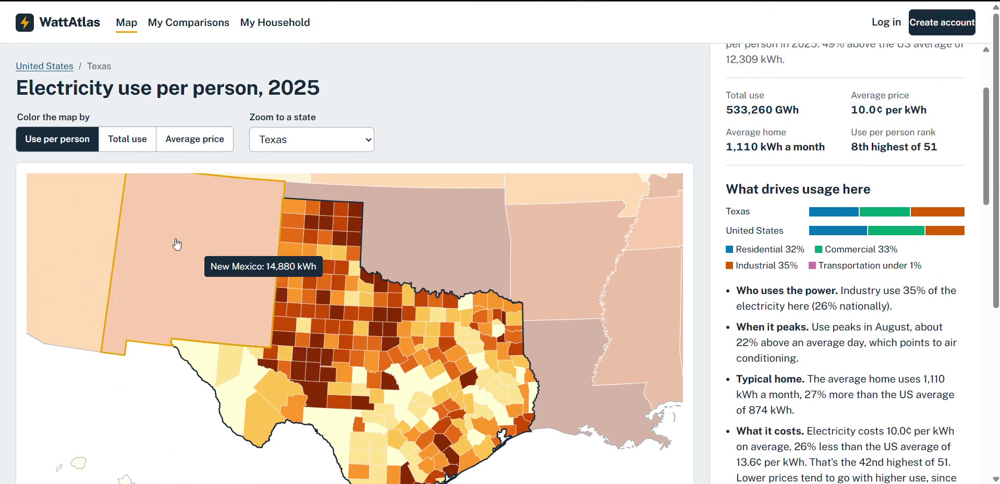
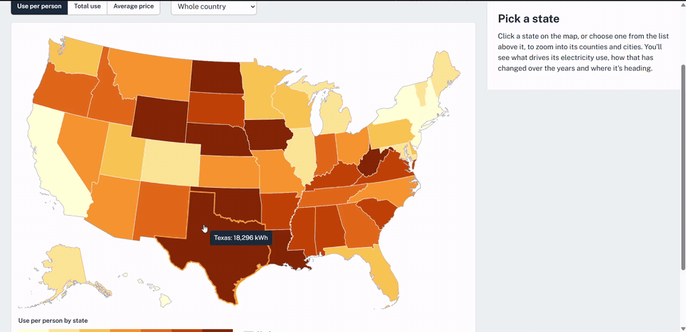

# WattAtlas, U.S. Electricity Explorer

An interactive map of electricity use across the United States. Zoom from the whole country into a state's counties and cities, see what drives a state's usage and where it is heading, track your own household's bills, and compare states and utility companies side by side.

Live site: https://wattatlas-frontend-nfdt.vercel.app/

## Authors

Sharthi Abhinay
sharthiabhinay@gmail.com

Emily Huang
huang.emil@northeastern.edu

## Class

CS 5610 Web Development, Northeastern University.
Instructor: John Alexis Guerra Gomez.
Course page: https://johnguerra.co/classes/webDevelopment_online_fall_2026/

## Project Objective

Government agencies publish electricity data in separate tools built for specialists. WattAtlas puts it in one place for the general public: someone relocating can see how much electricity people use in each state, what it costs and who supplies it, and a homeowner can check whether their own bills are normal for their area.

- **US map:** color the states by use per person, total use or average price. Click a state, or pick it from the list, to zoom into its counties.
- **State detail:** what drives a state's usage (homes, businesses and industry, the season it peaks, home usage and price compared with the US), how it has changed over ten years, a simple forecast for next year, and its cities.
- **State comparisons:** save named comparisons of up to four states with your own notes, then edit or delete them.
- **My Household:** say where you live and which utility serves you, log your monthly bills (kWh used and amount paid), and see the year's usage and cost month by month.
- **Utility companies:** see the companies that supply each county, with their customers, average home usage and price per kWh.
- **Utility comparisons:** save named comparisons of up to four utility companies with your own notes, with their figures and trends side by side.
- **Accounts:** sign up and log in, so your household, bills and comparisons are saved to you.

## Screenshot



A quick tour: the US map, zooming into Texas, and switching between use per person, total use and average price.



## Video Demo

Our narrated walkthrough: [watch on YouTube](https://youtu.be/BUHmGYSNuYw)

## Presentation Slides

Our project presentation: [view on Google Slides](https://docs.google.com/presentation/d/1DJTXsuCEUbzI2O_3V0Z_Tyu2axc9_q32dTd_eK-1Tz8/edit?usp=sharing)

## Design Document

[design.pdf](design.pdf) covers the project description, user personas, user stories and design mockups.

## Design

**Color:** a cool grey-blue background with deep slate text. Amber, like a light bulb filament, marks the selected state and keyboard focus. Usage maps use a yellow-to-brown scale and prices a purple-blue one, both from ColorBrewer, and chart lines use the Okabe-Ito colors so they stay distinct for color-blind readers.
**Type:** Public Sans, the typeface of the US Web Design System, chosen because all the data comes from US government sources. Figures use tabular numerals so columns line up.
**Signature detail:** a state's use per person is shown on dark digit wheels, like an electric meter.
**Accessibility:** every action is a real button or link, every input has a label, messages use `role="alert"`, each page has one main heading, and a state picker beside the map does everything clicking the map does.

## Tech Stack

| Layer      | Technologies                                                                    |
| ---------- | ------------------------------------------------------------------------------- |
| Frontend   | React 18 with Hooks, built with Vite; React Router; PropTypes                   |
| Charts     | D3, topojson-client, us-atlas                                                   |
| Backend    | Node.js, Express                                                                |
| Database   | MongoDB Atlas with the native driver (no Mongoose)                              |
| Auth       | Passport (local strategy), express-session, connect-mongo, bcrypt               |
| Data       | EIA Open Data API, NREL City and County Energy Profiles, EIA-861 utility survey |
| Tooling    | ESLint, Prettier                                                                |
| Deployment | Vercel                                                                          |

## Data

| Collection           | What it holds                                                         | Source                                          |
| -------------------- | --------------------------------------------------------------------- | ----------------------------------------------- |
| `stateSales`         | About 33,000 monthly records: 50 states and DC, 5 sectors, 2016 on    | EIA retail sales of electricity (Open Data API) |
| `places`             | 23,460 cities and 3,142 counties with modeled yearly use (2016)       | NREL City and County Energy Profiles            |
| `utilities`          | One document per electric utility: name, type and states served       | EIA-861                                         |
| `utilityStats`       | Customers, sales, revenue, average use and price per utility and year | EIA-861                                         |
| `utilityTerritories` | Which utilities serve which county, per year                          | EIA-861                                         |
| `users`              | Accounts: username and bcrypt password hash                           | Created by users                                |
| `comparisons`        | Saved state comparisons: name, up to four states, notes               | Created by users                                |
| `utilityComparisons` | Saved utility comparisons: name, up to four utilities, notes          | Created by users                                |
| `households`         | Where each user's household is and which utility serves it            | Created by users                                |
| `bills`              | One bill per household per month: kWh used and amount paid            | Created by users                                |

City and county figures are model estimates, and the app labels them that way. Use per person divides EIA sales by 2020 Census population.

## Project Structure

```
.
├── server/
│   ├── index.js             # Starts the server
│   ├── app.js               # Express app: sessions, Passport, API routes, built frontend
│   ├── config/              # MongoDB connection, session store, Passport, indexes
│   ├── middleware/          # requireAuth
│   ├── models/              # One file per collection
│   ├── routes/              # Auth, states, places, comparisons, household, bills, utilities
│   ├── lib/                 # State list, input checks, CSV parser, state figures, forecast
│   └── scripts/             # npm run seed:states, seed:places and seed:utilities
├── frontend/
│   ├── package.json         # Frontend dependencies
│   ├── vite.config.js       # Dev server forwards /api to Express
│   ├── index.html
│   └── src/
│       ├── App.jsx          # Routes, login state and the map page layout
│       ├── components/      # One folder per component, each with its own CSS
│       └── lib/             # fetch helpers, the useApiData hook, formatting
├── api/
│   └── index.js             # Entry point Vercel runs for every /api request
├── data/raw/                # Downloaded source CSV files (not committed)
├── images/                  # Screenshot shown in this README
├── design.pdf               # Personas, user stories and mockups
├── package.json             # Backend dependencies, scripts and Prettier settings
├── vercel.json              # Vercel build, output folder and routing
├── eslint.config.js         # ESLint config
├── LICENSE
└── README.md
```

## How the forecast works

For each calendar month, the forecast fits a straight line through that month's usage across the past years (all Januaries, all Februaries and so on) and extends it to next year. That keeps the state's seasonal shape while following its long-term direction. The shaded range is the standard least-squares prediction interval. It's a simple trend, not an official EIA forecast.

## Using WattAtlas

1. On the map, choose what to color the states by: use per person, total use or average price. Hover over a state to see its figure.
2. Click a state, or choose it under "Zoom to a state". The map zooms into its counties, and the panel on the right explains what drives its usage, shows ten years of history, forecasts next year and lists its cities.
3. Create an account (top right) to save your own data.
4. Under **My Household**, pick your state, county and utility, then add each month's bill, and edit or delete it later. The charts show the year's usage and cost, and the list shows the utilities serving your county.
5. Under **My Comparisons**, compare up to four states or up to four utility companies, add notes, and come back to edit or delete them. You can also start a state comparison from any state on the map.

## Instructions to Build

Requires Node.js 20.19 or newer and a MongoDB Atlas database.

### 1. Clone and install

```
git clone https://github.com/SharthiAbhinay/Wattatlas.git
cd Wattatlas
npm install
npm --prefix frontend install
```

### 2. Create a `.env` file

Copy `.env.example` to `.env` and fill in your own values. `.env` is listed in `.gitignore`, so it never reaches GitHub.

```
MONGODB_URI=<your MongoDB Atlas connection string>
DB_NAME=wattatlas
SESSION_SECRET=<a long random string>
EIA_API_KEY=<free key from https://www.eia.gov/opendata/register.php>
PORT=3000
NODE_ENV=development
```

Set `NODE_ENV=production` on the deployed server so login cookies are secure. `EIA_API_KEY` is only needed to load the state data.

### 3. Load the data

Run these in order. The utility data is matched to the counties, so the counties must be loaded first.

**States (EIA API).** Downloads about ten years of monthly sales for every state and sector:

```
npm run seed:states
```

**Cities and counties (NREL).** Download the corrected workbook from https://data.openei.org/submissions/149. From its City and County sheets, save two CSV files in `data/raw/` with these columns: `fips` (city_id or county_id), `state_abbr`, `city_name` or `county_name`, `population`, `residential_electricity_mwh`, `commercial_electricity_mwh` (the local calibration column), `industrial_electricity_mwh` and `year` (2016). Then:

```
npm run seed:places -- --type city --file data/raw/cities.csv
npm run seed:places -- --type county --file data/raw/counties.csv
```

**Utilities (EIA-861).** From https://www.eia.gov/electricity/data/eia861/, save the Utility Data, Sales to Ultimate Customers and Service Territory files for a year as CSV in `data/raw/utilities/<year>/`, named `Utility_Data_<year>.csv`, `Sales_Ult_Cust_<year>.csv` and `Service_Territory_<year>.csv`. Then load each year (we loaded 2020 to 2025):

```
npm run seed:utilities -- --year 2024
```

### 4. Start the app

In two terminals:

```
npm run dev
npm run dev:client
```

Then open http://localhost:5173.

To run it the way it runs when deployed, build the frontend and let Express serve it:

```
npm run build
npm start
```

Then open http://localhost:3000.

### 5. Lint and format

```
npm run lint
npm run format
```

## Deploying to Vercel

1. Push the repository to GitHub and import it in Vercel (**Add New > Project**). Leave the Root Directory as `./` and set the Framework Preset to **Other**. `vercel.json` already sets the install command, the build command and the output folder, so leave those settings as they are.
2. In the project's **Settings > Environment Variables**, add `MONGODB_URI`, `DB_NAME`, `SESSION_SECRET` and `NODE_ENV` set to `production`.
3. In MongoDB Atlas, under **Network Access**, allow access from anywhere (`0.0.0.0/0`), because Vercel's servers don't have fixed IP addresses.
4. Load the data from your own computer with the seed scripts above. They write straight to Atlas and create the database indexes, so the deployed app needs no extra setup.

Vercel builds the React app and serves it from its CDN. `api/index.js` runs the Express app as a Vercel Function for every `/api` request, and any other path returns `index.html`, so links like `/household` still work after a refresh.

## Security

- **No secrets in the repository.** The MongoDB connection string, the session secret and the EIA API key exist only in `.env` on each developer's computer and in Vercel's environment variables. `.env` is in `.gitignore`, and `.env.example` lists the variable names with no values.
- **No built-in fallbacks.** The server refuses to start without `MONGODB_URI` and `SESSION_SECRET` rather than falling back to a default value.
- **No demo accounts.** Neither this README nor any script contains a username or password; every account is created on the sign-up page.
- **Passwords** are hashed with bcrypt (12 rounds) and never sent back to the browser.
- **Sessions** are stored in MongoDB, and the session cookie is HTTP-only, SameSite=Lax and, in production, Secure.
- **Private data stays private.** Comparisons, households and bills are always looked up together with the logged-in user, so nobody can read or change another user's data.
- **Database access.** The app connects as an Atlas database user that only needs read and write access to the `wattatlas` database, with a long random password.

## GenAI Usage

### Sharthi Abhinay

Tool: Claude by Anthropic (claude.ai), model Claude Opus 5.5

Prompts used:

- "This is the rubric. Focus on the code-related items, correct the code and its structure to match, and follow the proposal only: don't add extras, and remove any that were added." (with the rubric attached)
- "Check for bugs, and make sure every function connects to the next without errors."
- "How do I convert the city and county CSV files?" (with the NREL workbook attached)
- "Complete the README file after going through the code files"
- "Make the files ready to deploy on Vercel."

### Emily Huang

Tool: Claude by Antropic, model Opus 5.5
- "Write a quick documentation on what is present in this code base and the funtion of each file. Keep it short."
- "What are the steps I would take to include utility company data into a code project? No code."
- "Which of these excel files from EIA are relevant to calculating the average monthly bill, average annual bill, average price, and average usage?"

## Sources and References

- EIA Open Data API, electricity retail sales: https://www.eia.gov/opendata/
- EIA-861 annual electric power industry report: https://www.eia.gov/electricity/data/eia861/
- NREL City and County Energy Profiles: https://data.openei.org/submissions/149
- us-atlas: https://github.com/topojson/us-atlas
- D3: https://d3js.org
- React: https://react.dev
- React Router: https://reactrouter.com
- Vite: https://vite.dev
- Passport: https://www.passportjs.org
- MongoDB Node.js driver documentation: https://www.mongodb.com/docs/drivers/node/current/
- Express on Vercel: https://vercel.com/docs/frameworks/backend/express
- ColorBrewer: https://colorbrewer2.org

## License

MIT License. See the LICENSE file for details.
